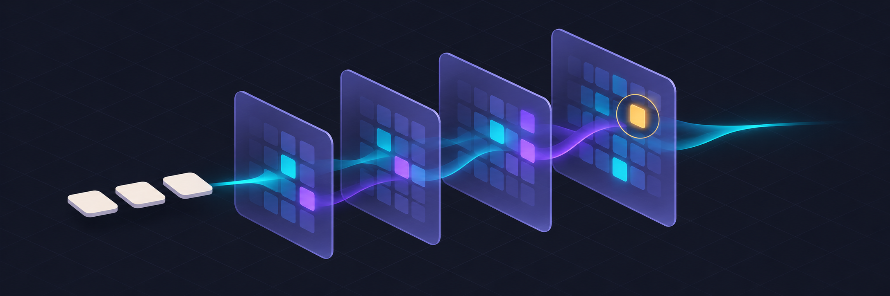
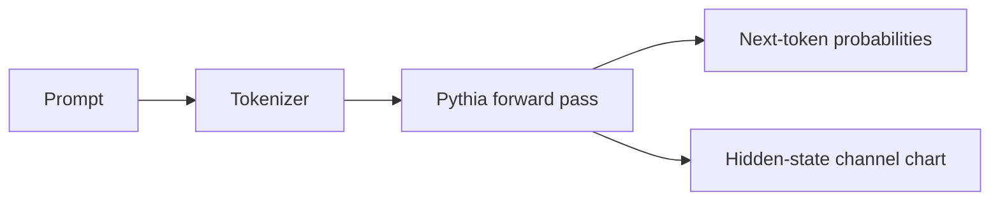

# Mechanistic Interpretability Dashboard



**What changes inside a language model as it processes a prompt?** A local Streamlit dashboard for exploring the next-token distribution and hidden states of [EleutherAI’s Pythia-70M](https://huggingface.co/EleutherAI/pythia-70m).

**Python 3.10+** · **CPU inference** · **Observation prototype**

[Quick start](#quick-start) · [How it works](#how-it-works) · [First causal experiment](#first-causal-experiment)

## Quick start

From the repository root, install dependencies in a virtual environment and run the dashboard.

```sh
python -m pip install -r requirements.txt
python -m streamlit run app.py
```

The first launch downloads public model weights from Hugging Face. Enter a short prompt, then select a hidden-state index and token position.

## How it works



| View | What it measures |
| --- | --- |
| Next-token probabilities | The ten most probable continuations at the last input position. |
| Hidden-state channels | Signed values for the sixteen highest-magnitude channels at a selected position and hidden-state index. |

A large activation is an observation. A causal claim needs an intervention and a comparison.

## First causal experiment

Activation patching is the next milestone. Run paired clean and corrupted prompts, then copy one clean activation into the matching site during a new corrupted forward pass. Compare the change in target-versus-distractor logit difference across prompts. Include a no-op patch and random-site controls. Attention maps and dictionary learning are later explorations.

- [Dashboard source](app.py)
- [Model card and limitations](https://huggingface.co/EleutherAI/pythia-70m)
